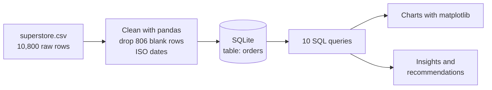

<p align="center">
  
</p>

<p align="center">
  
  
  
  
  
</p>

<p align="center">
  <b>What drives sales and profit at a retail store, and where does it lose money?</b><br>
  Ten SQL queries on 9,994 orders answer that, from discounts to regions to seasonality.
</p>

---

## Table of contents
- [Highlights](#highlights)
- [Business questions](#business-questions)
- [Key findings](#key-findings)
- [Visuals](#visuals)
- [SQL showcase](#sql-showcase)
- [Recommendations](#recommendations)
- [Workflow](#workflow)
- [Getting started](#getting-started)
- [Repository structure](#repository-structure)
- [Dataset](#dataset)
- [Limitations](#limitations)
- [Author](#author)

## Highlights

| Total sales | Total profit | Profit margin | Orders | Customers |
|:---:|:---:|:---:|:---:|:---:|
| **$2.30M** | **$286K** | **12.47%** | **5,009** | **793** |

- Discounts above 40% turn sales into a **-77.4% margin**; orders with no discount earn **+29.5%**.
- **Furniture** brings in almost as much revenue as Technology but keeps only a **2.49%** margin.
- Sales grew **29.5%** in 2017 and **20.4%** in 2018, and peak every **September to December**.

## Business questions

1. What are the overall sales, profit and margin?
2. Which categories, sub-categories and regions are most and least profitable?
3. How have sales grown year over year, and is there seasonality?
4. How do discounts affect profit?
5. Who are the most valuable customers, and which segments matter most?
6. Does shipping mode affect delivery time?

## Key findings

| Area | Finding |
|---|---|
| **Category** | Technology (17.4% margin) and Office Supplies (17.0%) are strong; Furniture earns 2.49% |
| **Sub-category** | Copiers (+$55.6K), Phones (+$44.5K) and Accessories (+$41.9K) lead; Tables (-$17.7K), Bookcases (-$3.5K) and Supplies (-$1.2K) lose money |
| **Region** | West is best (14.94% margin); Central is weakest (7.92%) despite high sales |
| **States** | Texas (-$25.7K), Ohio (-$17.0K), Pennsylvania (-$15.6K) and Illinois (-$12.6K) lose the most |
| **Growth** | Sales: 2016 -2.8%, 2017 +29.5%, 2018 +20.4%; profit rose every year |
| **Seasonality** | November ($352K), December ($325K) and September ($308K) are the top months |
| **Discounts** | No discount: +$321K profit. Above 20%: a combined -$135K loss |
| **Customers** | 98.5% of customers ordered more than once (6.3 orders on average) |
| **Shipping** | Same Day 0.04 days, First Class 2.18, Second Class 3.24, Standard 5.01 |

## Visuals

<p align="center">
  
  
</p>
<p align="center">
  
  
</p>

## SQL showcase

All queries live in [`sql/queries.sql`](sql/queries.sql) and in the notebook. Techniques used: aggregation, `GROUP BY` / `HAVING`, `CASE` bands, CTEs, the `LAG` window function and date functions (`strftime`, `julianday`).

<details>
<summary><b>Year-over-year growth (CTE + window function)</b></summary>

```sql
WITH yearly AS (
    SELECT CAST(strftime('%Y', order_date) AS INTEGER) AS year,
           SUM(sales)  AS sales,
           SUM(profit) AS profit
    FROM orders
    GROUP BY year
)
SELECT year,
       ROUND(sales, 2)  AS sales,
       ROUND(profit, 2) AS profit,
       ROUND(100.0 * (sales - LAG(sales) OVER (ORDER BY year))
                   / LAG(sales) OVER (ORDER BY year), 2) AS sales_growth_pct
FROM yearly
ORDER BY year;
```
</details>

<details>
<summary><b>Discount impact on profit (CASE bands)</b></summary>

```sql
SELECT CASE
           WHEN discount = 0    THEN '1. No discount'
           WHEN discount <= 0.2 THEN '2. Up to 20%'
           WHEN discount <= 0.4 THEN '3. 21-40%'
           ELSE                      '4. Over 40%'
       END                                        AS discount_band,
       COUNT(*)                                   AS line_items,
       ROUND(SUM(sales), 2)                       AS sales,
       ROUND(SUM(profit), 2)                      AS profit,
       ROUND(100.0 * SUM(profit) / SUM(sales), 2) AS margin_pct
FROM orders
GROUP BY discount_band
ORDER BY discount_band;
```

| Discount band | Line items | Sales ($) | Profit ($) | Margin |
|---|---:|---:|---:|---:|
| No discount | 4,798 | 1,087,908 | 320,988 | 29.51% |
| Up to 20% | 3,803 | 846,522 | 100,785 | 11.91% |
| 21-40% | 460 | 234,138 | -35,817 | -15.30% |
| Over 40% | 933 | 128,632 | -99,559 | -77.40% |
</details>

## Recommendations

1. **Cap discounts.** Avoid discounts above 20-30% unless clearing stock on purpose.
2. **Fix Furniture.** Review pricing and supplier cost for Tables and Bookcases.
3. **Investigate the Central region** and the loss-making states for discount and cost problems.
4. **Review large accounts** before offering more discounts, and reward profitable repeat customers with loyalty offers instead of price cuts.
5. **Plan stock and marketing** around the September to December peak.
6. **Grow high-margin lines** such as Copiers, Accessories and Paper.

## Workflow



## Getting started

**Requirements:** Python 3.9 or newer.

```bash
git clone https://github.com/abhinav-kumar-ece/superstore-sql-analysis.git
cd superstore-sql-analysis
python -m venv .venv
source .venv/bin/activate        # Windows: .venv\Scripts\activate
pip install -r requirements.txt
jupyter notebook Abhinav_SuperstoreSQL.ipynb
```

Run all cells from the top. `superstore.csv` must be in the same folder as the notebook; charts are written to `charts/`.

**Run the SQL on its own** (needs the `sqlite3` command-line tool):

```bash
python build_db.py                      # creates superstore.db from the CSV
sqlite3 -header -column superstore.db < sql/queries.sql
```

## Repository structure

```
superstore-sql-analysis/
├── Abhinav_SuperstoreSQL.ipynb   # Notebook: cleaning, SQL, charts, insights
├── Abhinav_ProjectReport.docx    # Full written report
├── README.md
├── requirements.txt
├── superstore.csv                # Dataset
├── build_db.py                   # Builds superstore.db for the standalone SQL
├── sql/
│   └── queries.sql               # All 12 queries, commented
├── charts/                       # Saved chart images
├── assets/
│   └── banner.svg
├── .gitignore
└── LICENSE
```

## Dataset

Sample Superstore, a widely shared public retail sample dataset: 9,994 order line items after cleaning, January 2015 to December 2018, 21 columns (order, customer, location, product, sales, quantity, discount and profit fields).

**Cleaning steps:** removed 806 blank trailing rows, confirmed no duplicates, converted `m/d/yyyy` dates to ISO format, and left 11 missing postal codes (all Burlington, Vermont) as they are not used in the analysis.

## Limitations

- This is a sample dataset, so results describe this data and may not generalise to other retailers.
- Cost breakdowns are not available, so the cause of a loss (price, cost or discount) is inferred, not proven.
- The analysis is descriptive; it shows where problems are, not what would happen if prices or discounts changed.

## Author

**Abhinav Kumar**, B.Tech in Electronics and Communication Engineering (2026), Babasaheb Bhimrao Ambedkar University, Lucknow.

[](https://github.com/abhinav-kumar-ece)
[](https://linkedin.com/in/abhinav-kumar-446a03282)

Built as part of the **IBM SkillsBuild Data Analytics with AI Internship 2026** (AICTE in association with BharatCares). Released under the [MIT License](LICENSE).
